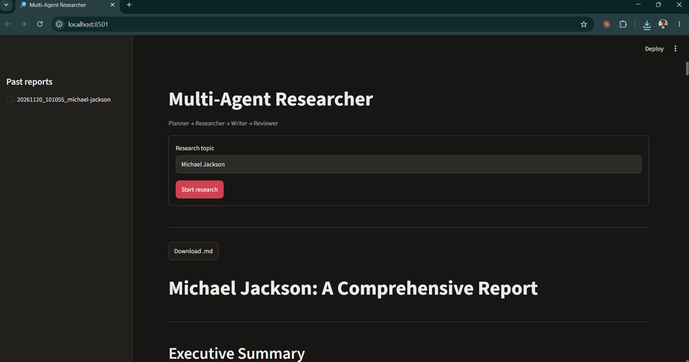

# Multi-Agent Researcher

A research assistant built with [CrewAI](https://www.crewai.com/). You give it a topic, and four AI agents plan the research, search the web, write a report and review it. You get back a clean Markdown report.

<p align="center">
  
</p>

## Features

- **Four specialized agents** working in sequence: planner, researcher, writer and reviewer
- **Live web search** through the Serper API
- **Web UI** (Streamlit) to start a research, follow each step, read the report and download it
- **CLI** for quick runs from the terminal
- **Report history**: every run is saved to its own file, so nothing gets overwritten
- **Configurable** model, temperature and verbosity through a `.env` file
- Logging to file and console, plus a pytest suite

## How it works

The agents run one after the other and each one gets the previous agent's output as context:

```text
Topic ──▶ Planner ──▶ Researcher ──▶ Summarizer ──▶ Reviewer ──▶ Markdown report
                          │
                          └── Serper web search
```

| Agent | What it does |
|-------|--------------|
| **Planner** | Reads the request and splits it into the sections that need to be investigated |
| **Researcher** | Goes through the plan, searches the web when needed and collects notes for each section |
| **Summarizer** | Turns the notes into a report with title, executive summary, main sections and conclusion |
| **Reviewer** | Checks consistency, duplicates, missing parts and unsupported claims, then writes the final version |

Agents and tasks are defined in YAML (`src/config/agents.yaml`, `src/config/tasks.yaml`), so you can change their roles and instructions without touching the Python code.

## Getting started

### Requirements

- Python 3.11 or newer (tested on 3.13)
- An [OpenAI](https://platform.openai.com/) API key
- A [Serper](https://serper.dev/) API key for web search

### Installation

```bash
git clone https://github.com/francescomv98/multi-agent-researcher.git
cd multi-agent-researcher

python -m venv venv
venv\Scripts\activate        # Windows
# source venv/bin/activate   # macOS / Linux

pip install -r requirements.txt
```

### Configuration

Create a `.env` file in the project root:

```env
OPENAI_API_KEY=your_openai_api_key
SERPER_API_KEY=your_serper_api_key

# Optional
MODEL_NAME=gpt-4.1-mini
TEMPERATURE=0.2
VERBOSE=true
```

| Variable | Required | Default | Description |
|----------|----------|---------|-------------|
| `OPENAI_API_KEY` | yes | – | Key used by the agents' LLM |
| `SERPER_API_KEY` | yes | – | Key used by the web search tool |
| `MODEL_NAME` | no | `gpt-4.1-mini` | Model used by all agents |
| `TEMPERATURE` | no | `0.2` | Sampling temperature |
| `VERBOSE` | no | `true` | Show agents' reasoning in the console |

The `.env` file is loaded with `pydantic-settings` and is ignored by git.

## Usage

### Web UI

```bash
streamlit run app.py
```

Streamlit opens the app at `http://localhost:8501`. Type a topic, press **Start research** and follow the agents' progress. When the report is ready you can read it on the page or download it as `.md`. Older reports are listed in the sidebar.

### Command line

```bash
python main.py
```

```text
Research topic: Renewable energy in Italy
```

### Output

Each run writes its report to `output/reports/`, named after the date and topic:

```text
output/reports/20261120_101500_renewable-energy-in-italy.md
```

Logs are written to `logs/app.log`. Both folders are ignored by git.

> A full run makes several LLM calls and web searches, so it usually takes a few minutes and uses some API credit.

## Project structure

```text
multi-agent-researcher/
├── app.py                    # Streamlit web UI
├── main.py                   # CLI entry point
├── requirements.txt
├── src/
│   ├── crew.py               # Agents, tasks and crew definition
│   ├── research.py           # Runs the crew and saves the report
│   ├── config/
│   │   ├── agents.yaml       # Agent roles, goals and backstories
│   │   ├── tasks.yaml        # Task descriptions and expected outputs
│   │   ├── llm.py            # LLM setup
│   │   └── settings.py       # Settings loaded from .env
│   ├── models/
│   │   └── report.py         # Pydantic models for the report structure
│   ├── tools/
│   │   └── search_tool.py    # Serper web search tool
│   └── utils/
│       ├── logger.py
│       ├── report_writer.py  # Report file naming and saving
│       └── validator.py
├── tests/
└── output/reports/           # Generated reports
```

## Testing

```bash
pytest
```

The tests cover the report models, the validator and the report writer (file naming and saving). They don't call any external API.

## Roadmap

- Wire the Pydantic report models into the crew (`output_pydantic`) so the final report is validated before it's saved
- List the sources used by the researcher at the end of the report
- Let the user pick the model and the depth of the research from the UI
- Docker image for easier deployment

## Why I built it

I wanted to explore agentic AI architectures in practice: how several agents can work together, how to orchestrate LLM calls and how far an automated research and writing pipeline can go.
